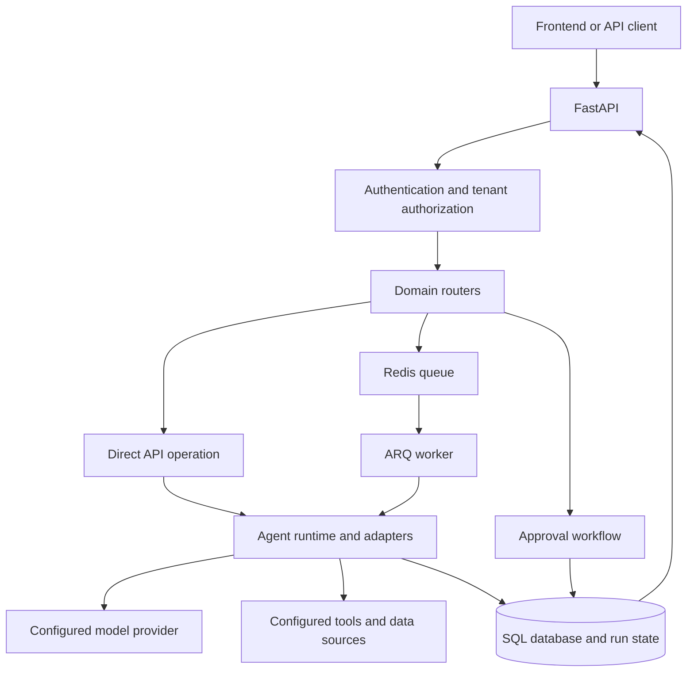

# Operon Backend

The backend is a FastAPI service that handles authentication, tenant-scoped APIs, agent definitions and runs, integrations, data sources, tools, evaluations, and approvals. It owns model/provider access and persistent application state. The frontend lives in a separate repository; see the [frontend guide](https://github.com/Operon-Operation-Platform/frontend/blob/feat/core-frontend-features/frontend/README.md).

## Requirements

- Python 3.12
- PostgreSQL for production; SQLite can be used for local development
- Redis when using queued background work with ARQ
- A model-provider token for provider-backed agent execution

## Local API setup

The Python application and its dependency file are under `app/` in this repository:

```powershell
cd app
py -3.12 -m venv .venv
.\.venv\Scripts\Activate.ps1
python -m pip install -r requirements.txt
$env:SECRET_KEY = "<generate-a-local-only-random-value>"
uvicorn main:app --reload --host 0.0.0.0 --port 8001
```

Do not commit the local secret or any `.env` file. The API health endpoint is `GET /` at `http://localhost:8001/`; interactive API documentation is normally available at `http://localhost:8001/docs`.

## Environment and services

The application reads configuration from environment variables. Important settings include:

| Setting | Purpose |
| --- | --- |
| `SECRET_KEY` | Required signing key; supply through a secret manager in hosted environments. |
| `DATABASE_URL` | Database connection; local configuration can fall back to SQLite, production should use persistent PostgreSQL. |
| `REDIS_URL` | Redis connection for queued work; defaults to a local Redis address. |
| `HF_TOKEN` | Optional provider credential for model-backed functionality. |
| `FRONTEND_HOST` | Allowed frontend host used by the deployment configuration. |
| `PORT` | HTTP listener port; hosted services commonly provide this at runtime. |

The Compose file is `app/compose.yaml`. It starts the API, an ARQ worker, and Redis. Compose expects an ignored local `app/.env` file because the services load environment from it. Put local values there; do not add that file or an `.env.example` containing real credentials to Git.

```powershell
cd app
docker compose up --build
```

## Request and agent flow



The API validates and authorizes requests before routing domain work. Work may run directly or through the worker. Agent execution uses configured model and tool adapters, while application and run state is stored in the configured database. Approval routes expose the human review path for runs that require it.

## Docker and hosted deployment

`app/Dockerfile` packages the API for a container host. The Render Blueprint at the frontend repository root defines separate API and frontend services. Configure `SECRET_KEY`, database and Redis URLs, and provider credentials through Render's environment/secret settings. Use persistent managed PostgreSQL in production because container-local files are not durable. Redis must be reachable when queued work is enabled.

The root health endpoint only confirms that the API process answers HTTP requests; it does not prove that the database, Redis, model provider, or integrations are healthy. Verify those dependencies and a representative authenticated workflow in the deployment environment.

## Technical trade-offs

- **SQLite locally, PostgreSQL in production:** SQLite makes a small local setup easy. PostgreSQL supports the durable, concurrent service deployment expected in production; container-local SQLite is not a production persistence strategy.
- **Redis and ARQ for background work:** moving eligible jobs to a worker keeps request handling responsive and allows worker scaling. It introduces Redis availability and operational configuration requirements.
- **Provider adapters:** keeping model calls on the backend protects credentials and centralizes execution. Provider-backed features depend on valid credentials, network access, and provider availability.
- **Separate frontend and backend deployments:** each service can be built and scaled independently. Their public API URL, allowed frontend origin, and service host settings must agree.
