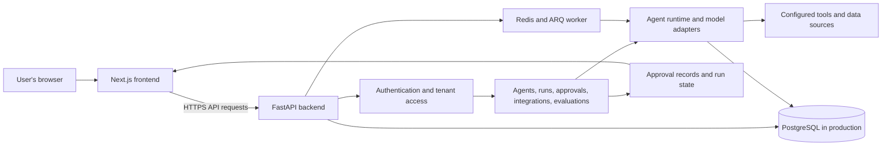

# Operon

Operon is a platform for building and operating AI agents. The web application lets users configure agents, connect data sources and tools, run evaluations, review approvals, and inspect live runs. The frontend and API are maintained in separate Git repositories and deployed as separate services.

## System architecture

The browser talks to the API over HTTP; model and tool work runs on the backend. PostgreSQL stores application data. Redis and an ARQ worker support queued work where configured. Approval decisions and run status return to the frontend for review.

## Repositories

- [Frontend guide](frontend/README.md) — local setup, build and deployment details.
- [Backend guide](https://github.com/Operon-Operation-Platform/backend/blob/feat/core-backend-implementation/README.md) — API setup, services, and backend architecture.

## Deployment overview

The Render Blueprint in this repository describes separate Docker services for the frontend and backend. The frontend receives the API host as a public build setting. The backend needs its signing secret and production database configuration; model-backed features may also need a provider token. Configure credentials in the hosting provider's secret settings, never in source control or `NEXT_PUBLIC_*` variables.

Production should use managed persistent PostgreSQL and a configured Redis service. The API's `/` endpoint is a basic process health check; it does not verify every external dependency. If service names or custom domains change, review the frontend API host and backend allowed frontend host settings.

## Local development

Run the frontend and backend independently. The frontend defaults to `http://localhost:8001` for its API. Backend-specific environment and Docker Compose instructions are in the [backend guide](https://github.com/Operon-Operation-Platform/backend/blob/feat/core-backend-implementation/README.md); frontend commands are in the [frontend guide](frontend/README.md).
