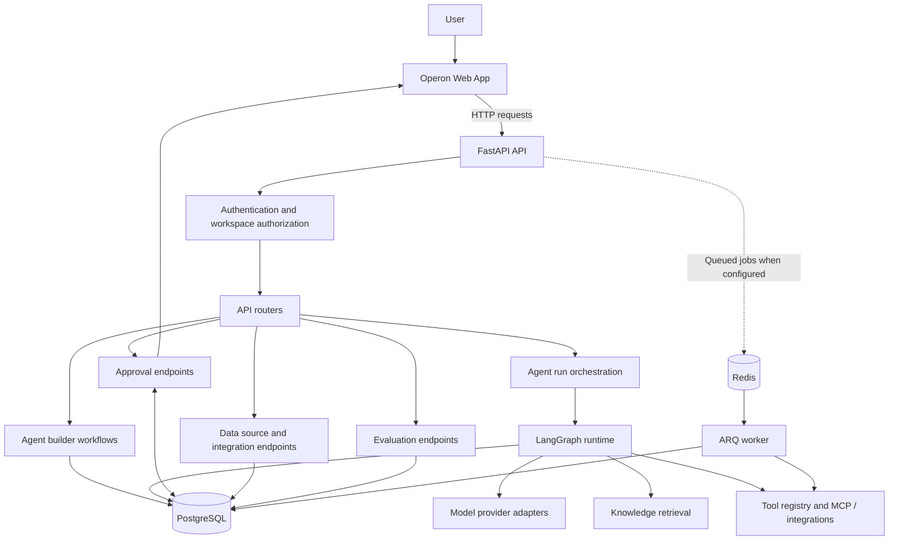
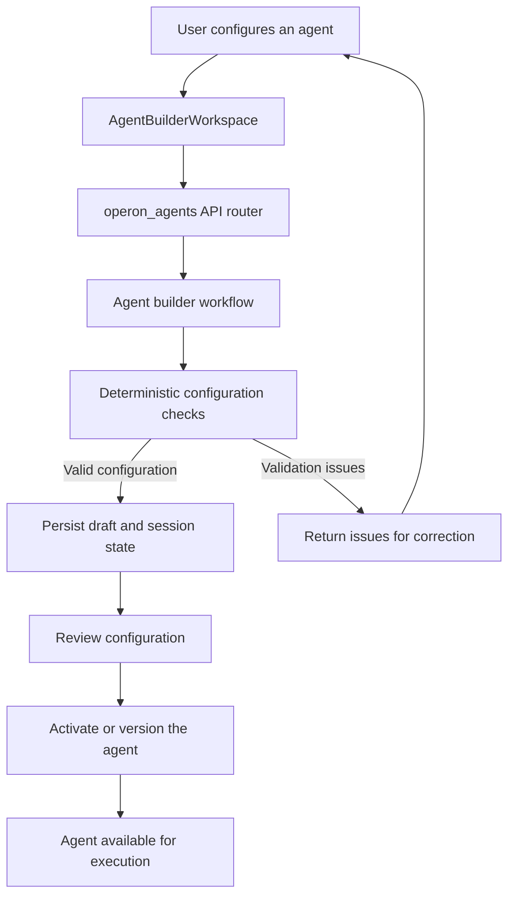
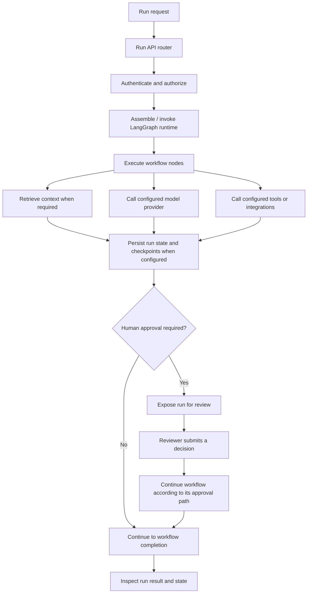
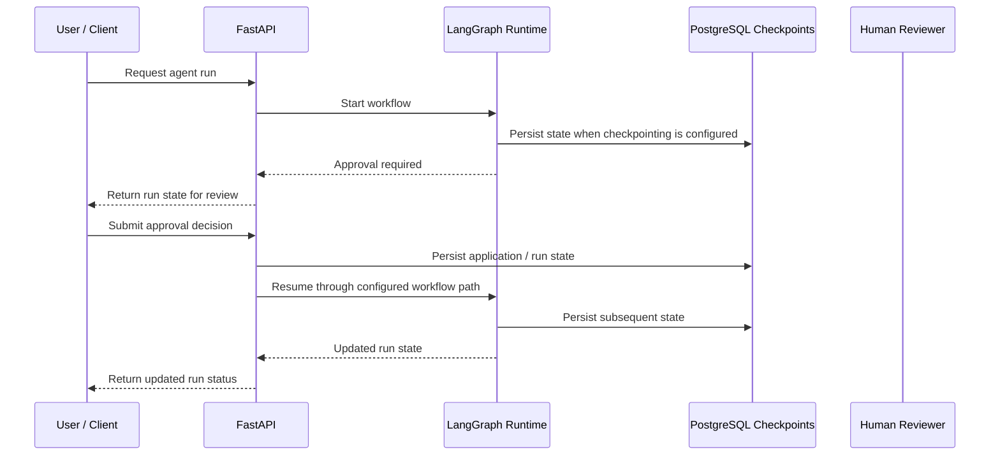
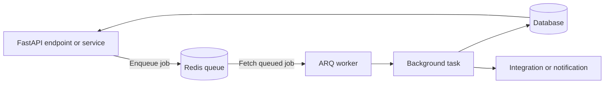

# Operon — AI Agent Operations Platform

Operon is a platform for building and operating AI agents. It brings agent configuration, data sources, tools, evaluations, human approvals, and run inspection into one application. Its backend uses FastAPI to coordinate application APIs and agent workflows, with PostgreSQL for persistent application data and LangGraph state, and Redis with ARQ for queued work when enabled.

The frontend and backend are maintained in separate Git repositories and deployed as separate services.

> **Project scope:** This README documents the current backend structure and workflows. Availability of a specific provider or integration depends on its configuration and credentials.

## Contents

- [What Operon does](#what-operon-does)
- [Architecture at a glance](#architecture-at-a-glance)
- [Core workflows](#core-workflows)
- [Technology stack](#technology-stack)
- [Repository layout](#repository-layout)
- [Run the backend locally](#run-the-backend-locally)
- [Configuration](#configuration)
- [API surface](#api-surface)
- [Data, state, and background work](#data-state-and-background-work)
- [Deployment](#deployment)
- [Security and operational considerations](#security-and-operational-considerations)
- [Verification checklist](#verification-checklist)
- [Engineering trade-offs](#engineering-trade-offs)

---

## What Operon does

The backend supports the following documented capabilities:

- **Agent building and lifecycle management:** Create and update agent configurations, maintain versions, and activate agents.
- **Stateful agent execution:** Assemble and run agent workflows, persist run state, and support resumable workflows where checkpointing is configured.
- **Tools and integrations:** Expose tool definitions through a registry and coordinate external integrations; MCP support is implemented in the `mcp_servers/` package.
- **Knowledge retrieval:** Ingest and retrieve reference material through the RAG modules.
- **Human-in-the-loop approvals:** Expose approval routes for runs that require review before continuing.
- **Evaluation and observability support:** Provide evaluation services and telemetry-related modules for inspecting and improving agent behavior.
- **Queued processing:** Use Redis and an ARQ worker for background jobs when queue processing is configured.

---

## Architecture at a glance

The browser communicates with the API over HTTP. The backend handles authorization and request routing, then invokes application workflows, agent execution, retrieval, or integrations. PostgreSQL stores durable application data and can persist LangGraph checkpoints. Redis and ARQ support asynchronous work when enabled.



### Architectural boundaries

- **API layer:** Validates incoming requests, applies authentication and authorization, and routes work to the appropriate domain module.
- **Agent runtime:** Assembles the execution graph and coordinates nodes, model calls, retrieval, and tools.
- **Persistence:** PostgreSQL is the recommended persistent database for production. The local configuration may fall back to SQLite where supported; SQLite in a container is not a durable production strategy.
- **Background processing:** Redis and ARQ are used for queued work when enabled. Direct request handling and queued processing are different execution paths.
- **External systems:** Model providers, MCP servers, and connected services are outside the application's direct availability boundary and need their own configuration and health checks.

---

## Core workflows

### 1. Build and activate an agent

The current web builder is `AgentBuilderWorkspace.js`. The API orchestration is in `api/routers/operon_agents.py`, and the staged workflow and draft state are managed by `agents/workflows/agent_builder_workflow.py`.



The builder's deterministic checks validate configured properties, such as instructions, knowledge/tool binding, and approval policy. Passing these checks does **not** prove that a model provider, external integration, or MCP server is reachable.

### 2. Execute an agent run



The graph runtime is assembled in `agents/graph.py`; nodes, runners, and support adapters live under `agents/nodes/`, `agents/runners/`, and `agents/adapters/`. The exact path a run takes depends on its configured workflow, tools, and approval policy.

### 3. Human-in-the-loop approval



Approval behavior depends on the workflow's policy and the configured persistence/checkpointing services. Test approval-required runs in the target environment before relying on them in production.

### 4. Queued background work

Redis and ARQ are optional for workflows that use background processing. The Compose setup under `app/compose.yaml` starts the API, worker, and Redis services.



A job is not automatically durable merely because it is queued: production behavior depends on Redis availability, worker health, retry configuration, and the task's own error handling.

---

## Technology stack

| Area | Technology / module | Responsibility |
|---|---|---|
| HTTP API | FastAPI | API application, request handling, routing, and lifecycle |
| Agent orchestration | LangGraph | Stateful agent workflows and checkpoint-based continuation |
| Database | PostgreSQL, SQLAlchemy, Alembic | Application records, database access, and schema migrations |
| Local fallback | SQLite where supported by configuration | Lightweight local development; not a production persistence strategy in ephemeral containers |
| Background jobs | Redis, ARQ | Queued job processing when enabled |
| Retrieval | `rag/` modules | Knowledge ingestion, retrieval, and augmentation |
| Tools and protocols | Tool registry, `services/`, `mcp_servers/` | Tool definitions, external integrations, and MCP support |
| Authentication / secrets | JWT utilities, secret vault | Access-token handling and encrypted integration credentials |
| Deployment | Docker, Docker Compose, Render Blueprint | Containerized services and hosted deployment configuration |

---

## Repository layout

The main backend code lives under `app/` in the standalone backend repository.

| Path | Responsibility |
|---|---|
| `main.py` | FastAPI construction, CORS, service lifecycle, optional Redis/ARQ setup, checkpoint initialization, and health endpoint |
| `api/routers/` | HTTP endpoints for agent management, runs, approvals, integrations, data sources, evaluations, and related features |
| `api/background_tasks/` | ARQ worker and background processing modules, including legacy ticket workflows |
| `agents/` | Builder workflow, shared runtime context, graph assembly, nodes, runners, and adapters |
| `database/postgres/` | Database configuration, sessions, and ORM models |
| `alembic/` | Database migration configuration and migration history |
| `rag/` | Knowledge ingestion, retrieval, and augmentation |
| `mcp_servers/` | MCP client/server and protocol-related functionality |
| `services/` | Model providers, integrations, OAuth, secret vault, tools, evaluation, telemetry, and supporting logic |
| `model/schemas/` | Request and response schemas and related models |
| `Dockerfile` | Backend container image |
| `compose.yaml` | Local API, worker, and Redis services |
| `requirements.txt` | Python dependencies |
| `verify_operon_backend.py` | Backend verification utility; consult the script for its supported arguments and checks |

The current builder UI entry point is `frontend/src/components/operon/AgentBuilderWorkspace.js` in the separate frontend repository. `AgentWizard.js` is an older template flow and is not the current `/operon` builder entry point.

---

## Run the backend locally

### Prerequisites

- Python 3.12
- PostgreSQL for a production-like local setup
- Redis if you want to run queued background jobs
- Credentials for the model provider and integrations you plan to exercise

### 1. Create and activate a virtual environment

From the backend repository root:

**Windows PowerShell**

```powershell
cd app
py -3.12 -m venv .venv
.\.venv\Scripts\Activate.ps1
python -m pip install --upgrade pip
python -m pip install -r requirements.txt
```

**macOS / Linux**

```bash
cd app
python3.12 -m venv .venv
source .venv/bin/activate
python -m pip install --upgrade pip
python -m pip install -r requirements.txt
```

### 2. Configure environment variables

Set at least `SECRET_KEY` and the database configuration appropriate to your setup. See [Configuration](#configuration) below. Do not commit `.env` files or real credentials.

For PowerShell, for example:

```powershell
$env:SECRET_KEY = "<generate-a-random-local-secret>"
$env:DATABASE_URL = "<your-database-connection-string>"
```

For macOS / Linux:

```bash
export SECRET_KEY="<generate-a-random-local-secret>"
export DATABASE_URL="<your-database-connection-string>"
```

Use the database URL format expected by the project's SQLAlchemy driver and configuration. If your chosen local setup relies on the documented SQLite fallback, confirm that the features you need support it; PostgreSQL is required for a production-like setup.

### 3. Start the API

From the `app/` directory with the environment configured:

```bash
uvicorn main:app --reload --host 0.0.0.0 --port 8001
```

The root health endpoint is available at `http://localhost:8001/`. Interactive API documentation is normally available at `http://localhost:8001/docs`.

### 4. Start the local services with Docker Compose

The Compose file expects an ignored local `app/.env` file because the services load environment values from it.

```bash
cd app
docker compose up --build
```

Configure the required database, secret, Redis, and provider values in `app/.env` first. Check `app/compose.yaml` for the service ports and mappings used by your checkout.

---

## Configuration

The backend reads configuration from environment variables. Exact requirements depend on which features and providers you enable.

| Variable | Purpose |
|---|---|
| `SECRET_KEY` | Required signing secret for JWT-related authentication. The secret vault also derives its Fernet key from this value. |
| `DATABASE_URL` | Database connection. PostgreSQL is recommended for durable local and production setups; local configuration may fall back to SQLite where supported. |
| `REDIS_URL` | Redis connection for queued background work; configuration defaults to a local Redis address. |
| `FRONTEND_HOST` | Frontend host used by deployment CORS configuration where supported by the selected backend checkout. |
| `PORT` | HTTP listener port, commonly supplied by the hosting platform. |
| `HF_TOKEN` | Optional credential for Hugging Face-backed inference functionality. |
| `META_KEY` | Optional provider credential read by database/provider configuration. |
| `QWEN_KEY` | Optional provider credential read by database/provider configuration. |
| `GOOGLE_AI_KEY` | Optional provider credential read by database/provider configuration. |
| `GROQ_KEY` | Optional provider credential read by database/provider configuration. |

Set provider credentials only for the providers you use. Never expose backend credentials through frontend variables prefixed with `NEXT_PUBLIC_`. Keep secrets in a local ignored environment file or the hosting provider's secret manager.

---

## API surface

The API is organized by router modules. Consult `/docs` on a running instance for the concrete paths, request schemas, and response models.

| Router module | Responsibility |
|---|---|
| `operon_auth.py` | Workspace authentication and sessions |
| `operon_agents.py` | Agent builder, configuration, lifecycle, and versions |
| `operon_runs.py` | Agent run operations and run state |
| `operon_approvals.py` | Human approval workflows |
| `operon_integrations.py` | Integration configuration and management |
| `operon_datasources.py` | Data-source configuration |
| `operon_tools_mcp.py` | Tool and MCP-related operations |
| `operon_evaluations.py` | Evaluation operations |
| `operon_platform_admin.py` | Platform administration |

The repository also includes legacy account and ticket modules. Their presence should not be interpreted as proof that every legacy route is part of the current Operon product flow.

---

## Data, state, and background work

### Persistence and resumability

- Application records are managed through the configured database layer.
- PostgreSQL-backed LangGraph checkpointing is initialized when PostgreSQL is used.
- Builder sessions and graph checkpoints support workflows that need to continue after interruption; migrations and state-schema changes must be coordinated with application code.
- Redis/ARQ provides a separate queue and worker path for jobs configured to run in the background.

### Retrieval and integrations

The RAG implementation is under `rag/ingestion.py`, `rag/retrieval.py`, and `rag/augumentation.py`. Retrieval quality depends on document freshness, indexing, permissions, and source attribution. The bundled `rag/enterprise_knowledge.pdf` is a reference/sample artifact, not evidence of a customer or tenant upload.

MCP support lives in `mcp_servers/`. Tool definitions are managed in `services/tool_registry.py`, while integration behavior is coordinated in `services/integration_service.py`. Treat MCP servers and external providers as external trust boundaries: verify their identity, authorization, inputs, and timeout behavior.

---

## Deployment

The project uses separate frontend and backend services. The root `render.yaml` Blueprint describes deployment for the combined project checkout, while the backend also has a separate repository and deployment configuration. Before deploying, confirm the repository, branch, Dockerfile, environment settings, and service URLs referenced by the Blueprint.

### Deployment checklist

1. Configure a strong `SECRET_KEY` through the host's secret settings.
2. Configure a managed, persistent PostgreSQL database.
3. Configure a reachable Redis service if queued jobs are enabled.
4. Add only the provider and integration credentials needed by the deployment.
5. Set the frontend's public API host to the deployed backend URL.
6. Configure the backend CORS allowlist to match the real frontend origin.
7. Confirm that the deployed backend listens on the host-provided `PORT` where required by the platform.
8. Verify the database, Redis/worker, model provider, and integrations independently of the root health endpoint.
9. Exercise an authenticated workflow, a representative agent run, and an approval-required run against the deployed environment.

> **Repository alignment note:** The backend worktree and the combined project checkout have previously differed in CORS handling and default listener ports. Treat the selected deployment source as authoritative and verify that its `main.py`, `Dockerfile`, Compose file, and Render settings agree before release. Do not assume that settings from one checkout apply to the other.

The `/` health endpoint is a **process liveness check**. A successful response does not prove that PostgreSQL, Redis, the worker, model providers, or external integrations are healthy.

---

## Security and operational considerations

- **Secrets:** Never commit `.env` files, provider credentials, signing keys, or integration secrets. Use the hosting platform's secret store in deployed environments.
- **Secret rotation:** The vault currently derives its Fernet key from `SECRET_KEY`. Changing that key without a re-encryption or migration plan can make already encrypted integration credentials unreadable.
- **Workspace isolation:** Enforce workspace ownership and authorization at every API endpoint and tool boundary. Frontend filtering is not an authorization control.
- **External calls:** Model providers, MCP servers, and integrations can fail independently. Add appropriate timeouts, error handling, and observability for each dependency.
- **Queue health:** Queued tasks require a reachable Redis service and healthy workers. A running API process does not establish that background processing is working.
- **Health checks:** Keep process liveness separate from dependency readiness. Verify key services and a representative authenticated user flow during release checks.
- **API-key management:** A workspace-scoped API-key hash/prefix model exists in the database layer. Confirm that creation, rotation, and revocation endpoints are implemented before documenting user-managed API keys as a supported feature.

---

## Verification checklist

Before treating a deployment as ready, verify the following manually or with the automated checks available in the selected checkout:

- [ ] The API starts and `/` responds.
- [ ] `/docs` loads and reflects the deployed API.
- [ ] The configured database is reachable and migrations are current.
- [ ] Redis and the ARQ worker are healthy when background processing is enabled.
- [ ] Required model-provider credentials are valid.
- [ ] A user can authenticate and access only their authorized workspace resources.
- [ ] An agent can be configured, validated, and activated.
- [ ] A representative run can execute and its state can be inspected.
- [ ] An approval-required run can pause, accept a decision, and follow the configured continuation path.
- [ ] Required retrieval sources and integrations work in the target environment.
- [ ] Frontend API configuration and backend CORS settings use the intended production origins.
- [ ] Logs do not expose credentials or sensitive integration values.

---

## Engineering trade-offs

| Decision | Benefit | Trade-off / operational concern |
|---|---|---|
| PostgreSQL for durable persistence | Durable state and concurrent application access | Requires managed database configuration, migrations, backups, and monitoring |
| SQLite fallback for local development | Low-friction setup for supported paths | Not appropriate as container-local production persistence; feature parity may differ |
| Redis and ARQ for background work | Keeps supported jobs out of the synchronous request path and allows separate worker scaling | Adds Redis/worker availability and retry/recovery concerns |
| LangGraph checkpointing | Supports stateful and resumable workflows | Requires compatible database setup and careful state-schema changes |
| Provider adapters and tool registry | Centralizes model and tool access behind backend services | External provider availability, credentials, and API changes still affect execution |
| RAG-based knowledge access | Gives agents relevant reference material at execution time | Answers depend on source quality, indexing freshness, permissions, and attribution |
| Separate frontend and backend deployments | Allows the services to build and scale independently | Public API host, CORS allowlist, environment configuration, and release versions must stay aligned |

---

## License

This project includes an MIT license. See [`LICENSE`](LICENSE) for the license text.
