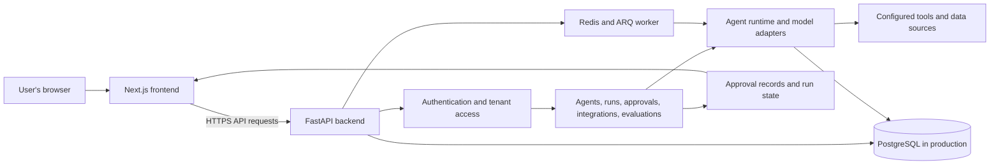
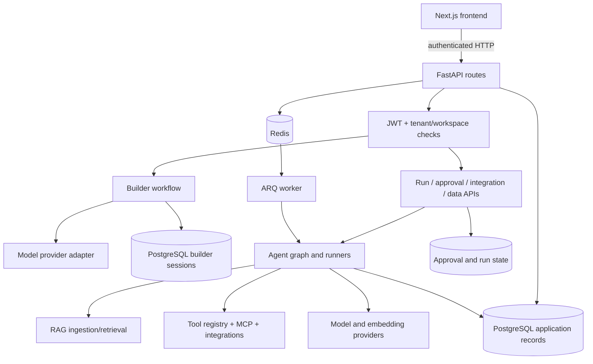
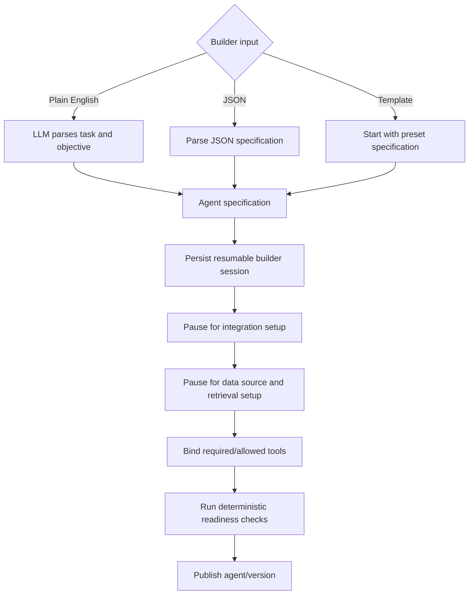
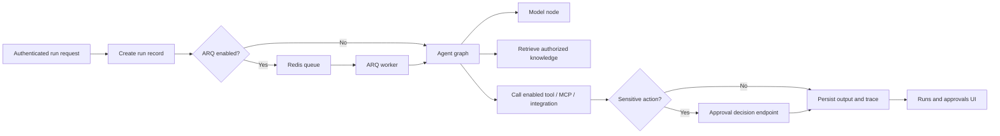
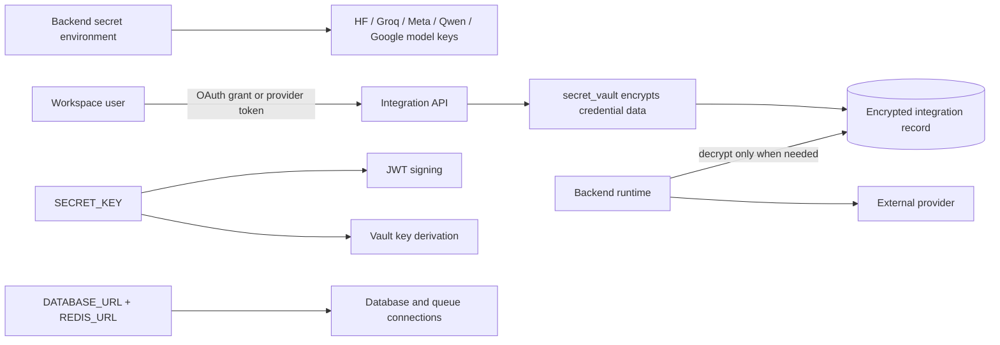

# Operon

Operon is a platform for building and operating AI agents. The web application lets users configure agents, connect data sources and tools, run evaluations, review approvals, and inspect live runs. The frontend and API are maintained in separate Git repositories and deployed as separate services.

## System architecture



The browser talks to the API over HTTP; model and tool work runs on the backend. PostgreSQL stores application data. Redis and an ARQ worker support queued work where configured. Approval decisions and run status return to the frontend for review.

## Repositories and guides

- [Frontend guide](https://github.com/Operon-Operation-Platform/frontend/blob/feat/core-frontend-features/frontend/README.md) — frontend setup, build, and deployment details.
- This README covers the backend API, its services, and the combined deployment.

## Backend requirements

- Python 3.12
- PostgreSQL for production; SQLite can be used for local development
- Redis when using queued background work with ARQ
- A model-provider token for provider-backed agent execution

## Local backend setup

The Python application and dependency file are under `app/`:

```powershell
cd app
py -3.12 -m venv .venv
.\.venv\Scripts\Activate.ps1
python -m pip install -r requirements.txt
$env:SECRET_KEY = "<generate-a-local-only-random-value>"
uvicorn main:app --reload --host 0.0.0.0 --port 8001
```

Do not commit the local secret or any `.env` file. The API health endpoint is `GET /` at `http://localhost:8001/`; interactive API documentation is normally available at `http://localhost:8001/docs`.

## Environment and services

The backend reads configuration from environment variables:

| Setting | Purpose |
| --- | --- |
| `SECRET_KEY` | Required signing key; provide it through a secret manager in hosted environments. |
| `DATABASE_URL` | Database connection; local configuration can fall back to SQLite, while production should use persistent PostgreSQL. |
| `REDIS_URL` | Redis connection for queued work; defaults to a local Redis address. |
| `HF_TOKEN` | Optional provider credential for model-backed functionality. |
| `FRONTEND_HOST` | Allowed frontend host used by the deployment configuration. |
| `PORT` | HTTP listener port, commonly supplied by the hosting platform. |

The Compose file is `app/compose.yaml`. It starts the API, an ARQ worker, and Redis. Compose expects an ignored local `app/.env` file because the services load environment from it. Put local values there; do not commit the file or credentials.

```powershell
cd app
docker compose up --build
```

## Request and agent flow

The API validates and authorizes requests before routing domain work. Work may run directly or through the worker. Agent execution uses configured model and tool adapters, while application and run state is stored in the configured database. Approval routes expose the human review path for runs that require it.

## Deployment

The combined project checkout's root `render.yaml` Blueprint defines separate Docker services for the frontend and API. Configure `SECRET_KEY`, database and Redis URLs, and provider credentials through Render's environment or secret settings. Use persistent managed PostgreSQL in production because container-local files are not durable. Redis must be reachable when queued work is enabled.

The root health endpoint only confirms that the API process answers HTTP requests; it does not prove that the database, Redis, model provider, or integrations are healthy. Verify those dependencies and a representative authenticated workflow in the deployment environment.

Production should use managed persistent PostgreSQL and a configured Redis service. The frontend receives the API host as a public build setting. The backend needs its signing secret and production database configuration; model-backed features may also need a provider token. Keep credentials in the hosting provider's secret settings, never in source control or `NEXT_PUBLIC_*` variables. If service names or custom domains change, review the frontend API host and backend allowed frontend host settings.

## Technical trade-offs

- **SQLite locally, PostgreSQL in production:** SQLite keeps local setup small. PostgreSQL supports durable, concurrent service deployment; container-local SQLite is not a production persistence strategy.
- **Redis and ARQ for background work:** queued jobs keep request handling responsive and allow worker scaling, while requiring Redis availability and configuration.
- **Provider adapters:** keeping model calls on the backend protects credentials and centralizes execution. Provider-backed features depend on valid credentials, network access, and provider availability.
- **Separate frontend and backend deployments:** each service can be built and scaled independently. Their public API URL, allowed frontend origin, and service host settings must agree.

## Full backend architecture



`main.py` creates the FastAPI app, configures CORS and lifespan services, initializes the database-backed LangGraph checkpointing when PostgreSQL is used, and starts Redis/ARQ services when configured. `api/routers/` contains HTTP endpoints; `agents/` contains builder and runtime logic; `database/postgres/` defines settings, sessions, and ORM tables; `services/`, `rag/`, and `mcp_servers/` provide model, connector, retrieval, and protocol behavior. Alembic migrations under `alembic/versions/` evolve the schema. `api/background_tasks/` contains the worker and ticket lifecycle tasks.

## Agent builder flow



The browser UI is `frontend/src/components/operon/AgentBuilderWorkspace.js`; API orchestration is in `api/routers/operon_agents.py`; stages and persisted draft state are in `agents/workflows/agent_builder_workflow.py`. Agent CRUD, activation, versions, and builder session endpoints share the agent router. The builder's deterministic checks validate configured properties such as instructions, knowledge-tool binding, and approval policy. They do not by themselves prove an external integration or model provider is reachable. The separate `AgentWizard.js` frontend component is an older template flow and is not the current `/operon` builder entry point.

## Runtime, data, and approvals



Important route modules include `operon_auth.py` (workspace sessions), `operon_agents.py`, `operon_runs.py`, `operon_approvals.py`, `operon_integrations.py`, `operon_datasources.py`, `operon_tools_mcp.py`, `operon_evaluations.py`, and `operon_platform_admin.py`. Legacy account/ticket modules include `authentication.py`, `admin.py`, `internal_admin.py`, `admin_fetch_tickets.py`, `users.py`, and `tickets.py`. Runtime graph assembly is in `agents/graph.py`; individual nodes are under `agents/nodes/`, agent runners under `agents/runners/`, and support-specific adaptation under `agents/adapters/`.

RAG code is in `rag/ingestion.py`, `rag/retrieval.py`, and `rag/augumentation.py`. `rag/enterprise_knowledge.pdf` is a bundled reference/sample file, not evidence of a tenant upload. MCP connectivity and protocol support are under `mcp_servers/`. Tool definitions are in `services/tool_registry.py`; connector behavior is in `services/integration_service.py`. Queued job setup is in `api/background_tasks/arq_worker.py`; the other background modules cover the older ticket workflow, notifications, escalation, semantic differences, and drift checks.

## Credential types and handling



`database/postgres/config.py` defines `HF_TOKEN`, `META_KEY`, `QWEN_KEY`, `GOOGLE_AI_KEY`, `GROQ_KEY`, database and Redis settings, and other optional service credentials. `services/hf_inference.py` reads `HF_TOKEN`; `services/llm_provider.py` handles model selection/parsing. `services/oauth2.py` creates and validates JWT access tokens using `SECRET_KEY`. `services/secret_vault.py` encrypts integration credential dictionaries and redacts secret-like fields in responses/log-safe structures.

Do not commit `.env` files or put secrets in frontend `NEXT_PUBLIC_*` settings. Configure production credentials using the host's secret environment. The vault currently derives its Fernet key from `SECRET_KEY`, so changing that secret without a re-encryption plan can make existing encrypted integration values unreadable. A `PlatformAPIKey` SQLAlchemy model stores a workspace-scoped key hash and prefix, but the inspected router files do not provide an evident API-key creation/rotation/revocation route. The model alone does not mean that users can manage personal Operon API keys in the application.

## Backend directory map

| Path | Responsibility |
| --- | --- |
| `main.py` | FastAPI construction, CORS, lifecycle, Redis/ARQ, graph checkpoint setup, scheduler, health endpoint. |
| `api/routers/` | HTTP endpoints for Operon and legacy account/ticket features. |
| `api/background_tasks/` | ARQ worker plus ticket persistence, response, escalation, drift, and semantic-diff jobs. |
| `agents/` | Shared state/context, builder workflow, execution graph, nodes, runners, and adapters. |
| `database/postgres/` | Environment settings, SQLAlchemy setup, and persisted records. |
| `alembic/` | Database migration configuration and version history. |
| `rag/` | Knowledge ingestion, retrieval, augmentation, and bundled reference PDF. |
| `mcp_servers/` | MCP client, protocol helpers, and Operon's MCP server. |
| `services/` | LLM/provider calls, integration connectors, OAuth, secret vault, evaluation, tools, telemetry, and helpers. |
| `model/schemas/` | Account, health, and request/response schema definitions. |
| `Dockerfile`, `compose.yaml`, `redis.conf` | Backend image and local API/worker/Redis services. |
| `requirements.txt` | Python dependencies. |
| `verify_operon_backend.py`, `paths.py`, `cache.py` | Verification and shared runtime helpers. |

## Additional tradeoffs and operational boundaries

- **Resumable workflow state:** storing builder sessions and graph checkpoints lets the user resume after an interruption or restart. It requires database migrations and careful coordination between serialized workflow state and application model changes.
- **Multi-tenant APIs:** tenant scoping prevents one workspace from seeing another's records, but each endpoint and tool must apply the same ownership checks; UI filtering alone is not a security boundary.
- **RAG and hybrid retrieval:** retrieval can reduce prompt size and surface source material, but document freshness, indexing quality, permissions, and source attribution affect answer quality.
- **MCP and external integrations:** they extend agent capabilities without embedding every provider into the core runtime, but create an external trust and availability boundary. Validate server identity, transport, authorization, tool inputs, and timeouts.
- **Health reporting:** `/` is a process liveness check only. Database, Redis, worker, provider, and integration readiness should be observed separately.
- **Local and deployment copies:** this backend worktree's `main.py` adds `FRONTEND_HOST` to CORS and its `Dockerfile` defaults to port `10000`. The root checkout's corresponding files differ: it does not add `FRONTEND_HOST` dynamically and defaults to `8001`. The Render blueprint references the backend repository/branch and supplies `FRONTEND_HOST`; choose the intended source and keep the relevant behavior aligned before release.

## Deployment and repository relationship

The backend has its own Git remote/repository. In this local project, `.worktrees/backend/` is a linked Git worktree for the backend branch; its `app/` is a second backend source copy relative to the root checkout. The frontend repository/README and the backend repository/README are maintained separately, and `render.yaml` refers to separate service repositories and branches. Check the active branch, remote, and worktree before committing or deploying; do not stage unrelated deleted paths from a different checkout.

The Compose file in `app/compose.yaml` runs API, worker, and Redis, but a production deployment should use managed persistent PostgreSQL and a reachable Redis service. The Dockerfile accepts the host-provided `PORT`; local defaults differ between the backend worktree and root copy, as noted above. Keep the public frontend API host and backend CORS allowlist aligned. The health endpoint does not validate external dependencies.
