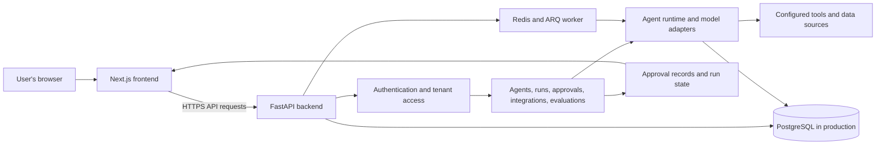

# Operon

Operon is a platform for building and operating AI agents. The web application lets users configure agents, connect data sources and tools, run evaluations, review approvals, and inspect live runs. The frontend and API are maintained in separate Git repositories and deployed as separate services.

## System architecture



The browser talks to the API over HTTP; model and tool work runs on the backend. PostgreSQL stores application data. Redis and an ARQ worker support queued work where configured. Approval decisions and run status return to the frontend for review.

## Repositories and guides

- [Frontend guide](frontend/README.md) — frontend setup, build, and deployment details.
- This README covers the backend API, its services, and the combined deployment.

## Backend requirements

- Python 3.12
- PostgreSQL for production; SQLite can be used for local development
- Redis when using queued background work with ARQ
- A model-provider token for provider-backed agent execution

## Local backend setup

The Python application and dependency file are under `app/`:

```powershell
cd app
py -3.12 -m venv .venv
.\.venv\Scripts\Activate.ps1
python -m pip install -r requirements.txt
$env:SECRET_KEY = "<generate-a-local-only-random-value>"
uvicorn main:app --reload --host 0.0.0.0 --port 8001
```

Do not commit the local secret or any `.env` file. The API health endpoint is `GET /` at `http://localhost:8001/`; interactive API documentation is normally available at `http://localhost:8001/docs`.

## Environment and services

The backend reads configuration from environment variables:

| Setting | Purpose |
| --- | --- |
| `SECRET_KEY` | Required signing key; provide it through a secret manager in hosted environments. |
| `DATABASE_URL` | Database connection; local configuration can fall back to SQLite, while production should use persistent PostgreSQL. |
| `REDIS_URL` | Redis connection for queued work; defaults to a local Redis address. |
| `HF_TOKEN` | Optional provider credential for model-backed functionality. |
| `FRONTEND_HOST` | Allowed frontend host used by the deployment configuration. |
| `PORT` | HTTP listener port, commonly supplied by the hosting platform. |

The Compose file is `app/compose.yaml`. It starts the API, an ARQ worker, and Redis. Compose expects an ignored local `app/.env` file because the services load environment from it. Put local values there; do not commit the file or credentials.

```powershell
cd app
docker compose up --build
```

## Request and agent flow

The API validates and authorizes requests before routing domain work. Work may run directly or through the worker. Agent execution uses configured model and tool adapters, while application and run state is stored in the configured database. Approval routes expose the human review path for runs that require it.

## Deployment

The root `render.yaml` Blueprint defines separate Docker services for the frontend and API. Configure `SECRET_KEY`, database and Redis URLs, and provider credentials through Render's environment or secret settings. Use persistent managed PostgreSQL in production because container-local files are not durable. Redis must be reachable when queued work is enabled.

The root health endpoint only confirms that the API process answers HTTP requests; it does not prove that the database, Redis, model provider, or integrations are healthy. Verify those dependencies and a representative authenticated workflow in the deployment environment.

Production should use managed persistent PostgreSQL and a configured Redis service. The frontend receives the API host as a public build setting. The backend needs its signing secret and production database configuration; model-backed features may also need a provider token. Keep credentials in the hosting provider's secret settings, never in source control or `NEXT_PUBLIC_*` variables. If service names or custom domains change, review the frontend API host and backend allowed frontend host settings.

## Technical trade-offs

- **SQLite locally, PostgreSQL in production:** SQLite keeps local setup small. PostgreSQL supports durable, concurrent service deployment; container-local SQLite is not a production persistence strategy.
- **Redis and ARQ for background work:** queued jobs keep request handling responsive and allow worker scaling, while requiring Redis availability and configuration.
- **Provider adapters:** keeping model calls on the backend protects credentials and centralizes execution. Provider-backed features depend on valid credentials, network access, and provider availability.
- **Separate frontend and backend deployments:** each service can be built and scaled independently. Their public API URL, allowed frontend origin, and service host settings must agree.
