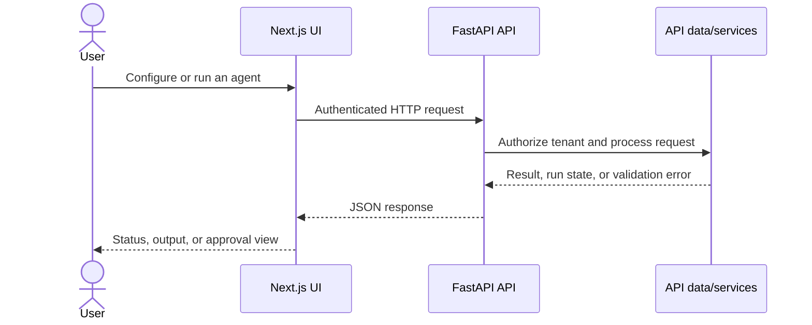

# Operon Frontend

The frontend is a Next.js application for configuring agents, managing integrations and data sources, testing agents, reviewing approvals, and following runs. It communicates with the Operon FastAPI backend; it does not contain backend credentials or execute model work itself.

## Requirements

- Node.js 22 or a compatible current LTS release
- npm
- A running Operon API for authenticated and data-backed features

## Local setup

From the repository root:

```powershell
cd frontend
npm ci
npm run dev
```

Open `http://localhost:3000`. By default, API requests target `http://localhost:8001`. See the [backend guide](https://github.com/Operon-Operation-Platform/backend/blob/feat/core-backend-implementation/README.md) to start the API.

## Configuration

The API base URL is selected in this order:

1. `NEXT_PUBLIC_API_BASE_URL` — full API base URL.
2. `NEXT_PUBLIC_API_HOST` — host name, to which the app adds `https://`.
3. Local default — `http://localhost:8001`.

`NEXT_PUBLIC_*` settings are exposed to browser code and embedded during the Next.js build. Set only public values there. Never put API keys, signing secrets, or user credentials in frontend variables.

## Useful commands

```bash
npm run dev       # local development server
npm run lint      # Oxlint checks
npm run build     # production build
npm start         # serve the standalone build after building
```

## Request flow



## Build and deployment

The Docker image uses Next.js standalone output to keep the runtime image focused on the production server. The container listens on port `10000` (or the `PORT` supplied by the host). The Render Blueprint builds the frontend separately and supplies the backend hostname as a public setting.

Because `NEXT_PUBLIC_*` values are build-time public configuration, changing the API hostname requires a new frontend build/deploy. The API must allow requests from the deployed frontend origin. Update the backend's allowed frontend host if the Render service name or public domain changes.

## Trade-offs and boundaries

- **Standalone Next.js output:** provides a compact production runtime, while requiring the image to be built with the intended public API host.
- **Browser-to-API requests:** keep model/provider credentials on the server and allow the UI and API to scale independently. The API must enforce authentication, tenant access, and origin policy.
- **No production mock fallback:** the UI expects the backend for real account and agent data. A reachable frontend alone does not mean API-backed workflows are available.

## Related documentation

- [Project overview](../README.md)
- [Backend guide](https://github.com/Operon-Operation-Platform/backend/blob/feat/core-backend-implementation/README.md)
